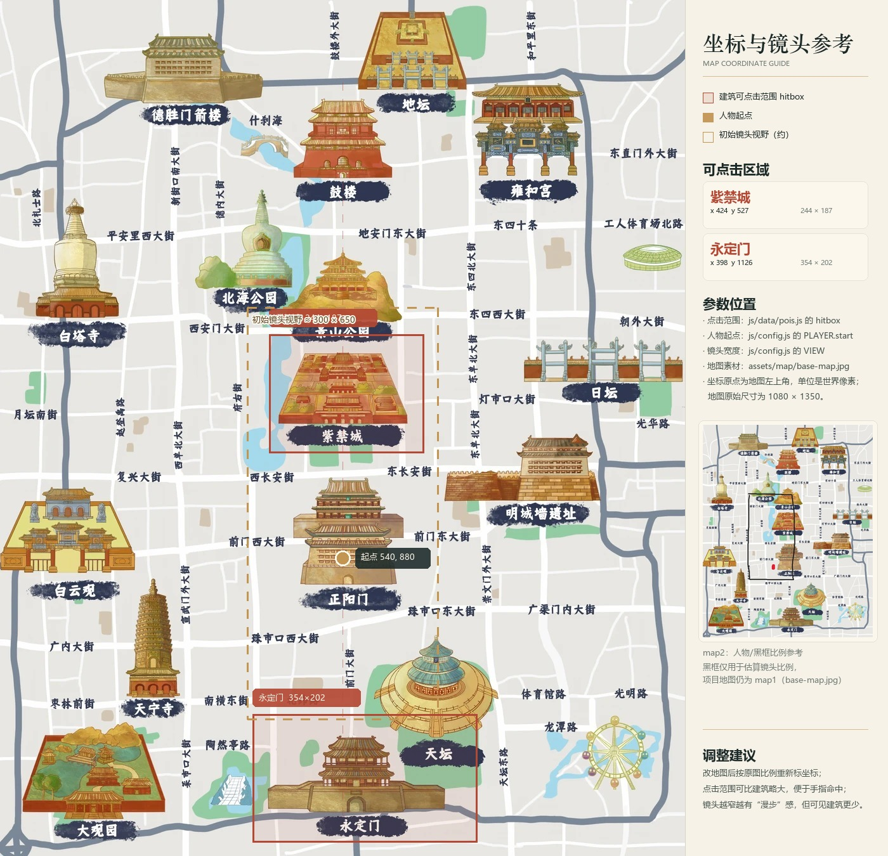

# 中轴漫行 · 北京中轴线数字漫游 Demo

面向研究生课程作业的**可玩性验证 Demo**：手机扫码即玩，人物在地图中四方位行走，镜头跟随；轻触「永定门」或「紫禁城」弹出介绍卡，并记录发现进度。

> **实现形态说明**：本项目是 **H5 + Canvas 2D 的移动端网页游戏**，不是微信原生小程序（`.wxml`）工程。它用手机浏览器扫码即可运行，适合课程演示和快速迭代。如果课程硬性要求提交微信小程序代码，玩法和数据结构可以迁移，但需要重写页面层与触摸适配，详见第 9 节。

---

## 1. 立即体验

### GitHub Pages（固定地址）

**https://taolegetao.github.io/zhongzhou-manxing/**


- 手机相机 / 微信扫一扫直接打开，无需登录。
- 由 GitHub Pages 托管，**电脑关机也能访问**；每次更新 `main` 分支后自动重新发布。
- 代码仓库：<https://github.com/taolegetao/zhongzhou-manxing>

### 同一 Wi-Fi 的本地入口（课堂备用）

电脑双击 `start-demo.bat` 后，手机连接同一个 Wi-Fi，扫描：


当前电脑的局域网地址：`http://10.4.35.161:4173/`  
（IP 可能随网络变化，以启动窗口打印的“手机访问”地址为准。）

### 分享海报 / 链接

- 海报 `扫码即玩.png` 是图片，不是可点击链接；对方需要**扫码或长按识别二维码**打开游戏。
- 也可以直接把 GitHub Pages 链接发到群里，点开即玩。
- 二维码在微信压缩到约 640px 宽、43KB 时仍可识别；不要裁掉二维码四角留白或贴纸遮挡。
- GitHub Pages 在部分校园网/移动网络下可能较慢；如果现场打不开，改用同一 Wi-Fi 的本地入口。

---

## 2. 本地启动（无代码操作）

1. 电脑安装 **Node.js 18 或更高版本**（<https://nodejs.org/>）。
2. 双击项目根目录的 **`start-demo.bat`**。
3. 保持弹出的黑色命令行窗口开启；约 2 秒后浏览器会自动打开 `http://localhost:4173`。
4. 手机与电脑连同一个 Wi-Fi，扫描 `qr-lan.png`；或手动输入窗口里打印的“手机访问”地址。
5. Windows 首次询问防火墙权限时，请选择**允许访问**。
6. 结束演示时，在命令行窗口按 `Ctrl + C`，或直接关闭窗口。

电脑也可以直接打开 `http://localhost:4173/qr.html` 查看并展示二维码。

### 常见问题

- **双击 `index.html` 打不开/白屏**：不能直接双击，ES Module 必须通过 HTTP 服务运行，请用 `start-demo.bat`。
- **端口被占用**：命令行执行 `node server.mjs --port 4174`，然后访问 `http://localhost:4174`。
- **手机打不开局域网地址**：确认同一 Wi-Fi、没有开启 AP 隔离；也可以直接扫 GitHub Pages 二维码。
- **GitHub Pages 打不开/加载慢**：换网络重试，或使用同一 Wi-Fi 的本地入口；公网地址不依赖电脑，但可能受网络环境影响。

---

## 3. 玩法

- **四方位行走**：拖动左下角摇杆；桌面端也支持 `WASD` / 方向键。
- **镜头跟随**：人物略微偏向屏幕下方，镜头多留出前方（北方）的探索空间。
- **轻触建筑**：靠近或看见「永定门」「紫禁城」时，轻触建筑图案或它的地图标签，弹出介绍卡。
- **发现进度**：顶部“发现 0 / 2”会记录读过的遗产点；两处都读完后显示完成提示。
- **归位**：右下角“归位”可把人物送回正阳门附近的起点。
- **帮助**：右上角“?”随时查看操作说明。

当前可交互的两处遗产点：

| 建筑 | 中轴位置 | 主要信息 |
| --- | --- | --- |
| 永定门 | 南端起点 | 明嘉靖三十二年（1553）始建，1957 年拆除，2004 年按清代形制复建 |
| 紫禁城 | 宫城核心 | 明永乐十八年（1420）建成，72 万平方米，前朝后寝、左祖右社 |

---

## 4. 已实现与验收点

- 原生 Canvas 2D 渲染，无运行时框架依赖。
- 四方向角色行走 + 序列帧动画 + 移动/停止状态切换。
- 平滑镜头跟随、地图边界钳制、响应式画布（DPR 适配）。
- 触屏虚拟摇杆、键盘输入、指针事件点击检测、摇杆与点击互不冲突。
- 两处建筑点击介绍、卡片内容由配置生成、发现进度与完成反馈。
- 开始页、HUD、帮助卡、介绍卡、Toast、安全区适配、竖屏提示。
- 平板/桌面居中手机预览框，方便课堂投屏。
- 基础无障碍：按钮焦点、Esc 关闭、焦点陷阱、`aria-live` 提示、`prefers-reduced-motion`。
- 已用 Chrome + Puppeteer 在 `390×844`、`320×568`、`1280×900` 三种尺寸验收；交互测试无页面报错。

预览图：

- [开始页](./docs/preview-start.jpg)
- [游戏画面](./docs/preview-game.jpg)
- [紫禁城介绍卡](./docs/preview-sheet.jpg)
- [永定门介绍卡](./docs/preview-yongdingmen.jpg)
- [完成状态](./docs/preview-complete.jpg)

---

## 5. 地图、坐标与比例

### 项目地图

**项目地图是 `map1.jpg`**，已复制为 `assets/map/base-map.jpg`，原始尺寸 **1080 × 1350**。

`map2.jpg` 没有作为项目地图使用，只保存在 `reference/map-scale-reference.jpg`，用于参考人物与手机黑框的比例。`reference/coordinate-guide.jpg` 标出了两处建筑的点击范围、人物起点和初始镜头视野：



### 取景比例

- 竖屏 `390 × 844` 时，镜头约显示 **300 × 650 世界像素**。
- 这也是 `map2` 黑框想要表达的“人物与地图缩放关系”：人物在画面里占比较小，地图被放大后随人物移动展现。
- 地图原始尺寸较大，所以在手机上看起来是“局部漫游”，不是整张地图一次性铺满。

### 当前坐标

| 对象 | 坐标 / 矩形（世界像素） |
| --- | --- |
| 地图 | `0, 0, 1080 × 1350` |
| 人物起点 | `x = 540, y = 880`（正阳门附近，接近 map2 红点） |
| 紫禁城点击区 | `x = 424, y = 527, w = 244, h = 187` |
| 永定门点击区 | `x = 398, y = 1126, w = 354, h = 202` |

坐标原点为地图左上角，x 向右、y 向下。

---

## 6. 替换素材

所有素材集中在 `assets/`，替换后刷新页面即可。

### 地图

- 路径：`assets/map/base-map.jpg`
- 推荐保持 **1080 × 1350** 或相同 **4:5** 比例。
- 换图后需要按新图重新标注建筑的 `hitbox` 和 `aura`（见第 7 节）。
- 如果新图分辨率不同，保持同一比例即可；代码使用的是图片原始像素坐标，不依赖显示尺寸。

### 人物

- 路径：`assets/character/hero.png`
- 当前为 **3 列 × 4 行**，每格 **48 × 48**，共 12 帧。
- 行顺序：**下、左、右、上**。
- 每行 3 帧，当前按 `0 → 1 → 2 → 1` 循环。
- 替换时保持同样的网格，或同步修改 `js/config.js` 中的：
  - `frameWidth` / `frameHeight`
  - `columns` / `rows`
  - `rowByFacing`
  - `drawSize`
  - `frameDuration`

### 介绍卡头图

- 路径：`assets/covers/yongdingmen.jpg`
- 路径：`assets/covers/zijincheng.jpg`
- 当前为 **720 × 360（2:1）**，从地图中裁切，避免和介绍卡标题重复。
- 可直接替换为同比例照片或插画。

### 颜色与字体

- UI 颜色集中在 `css/style.css` 顶部的 `:root` 变量。
- 字体使用系统中文字体回退（宋体 / 苹方 / 微软雅黑），不依赖外网字体，离线可用。

---

## 7. 修改文案、位置与新增建筑

### 两处建筑的文案

全部在 **`js/data/pois.js`**：

```js
{
  id: 'zijincheng',
  name: '紫禁城',
  kicker: '北京中轴线 · 宫城核心',
  cover: './assets/covers/zijincheng.jpg',
  hitbox: { x: 424, y: 527, width: 244, height: 187 },
  aura: { x: 542, y: 650, rx: 112, ry: 30 },
  tags: [...],
  lead: '...',
  body: '...',
  detail: { type: 'route', items: [...] }
}
```

- `lead`：介绍卡第一段（大字）。
- `body`：第二段（正文）。
- `tags`：标签。
- `detail`：`timeline` 时间线，或 `route` 中轴序列。
- `hitbox`：手指可点击的矩形。可以比建筑略大，方便命中。
- `aura`：靠近时地面提示光环的中心与半径。

**新增第三处建筑**：复制一项，改 `id`、文案、`cover`、`hitbox`、`aura`；发现计数和头图预加载会自动按数组读取，不需要改 UI。

### 人物、镜头、速度

在 **`js/config.js`**：

```js
PLAYER.start          // 出生点
PLAYER.speed          // 行走速度
PLAYER.bounds         // 可行走边界
VIEW.targetWorldWidth // 镜头远近：越小越近
VIEW.lookAheadY       // 镜头向北偏移
VIEW.proximity        // 出现“轻触查看”的距离
```

---

## 8. 代码结构

```text
zhongzhou-demo/
├─ index.html                 页面结构（开始页 / HUD / 介绍卡 / 帮助卡）
├─ css/style.css              视觉样式、动效、安全区与响应式
├─ js/
│  ├─ main.js                 启动、主循环、点击命中、状态编排
│  ├─ config.js               地图 / 人物 / 镜头 / 边界参数
│  ├─ data/pois.js            两处遗产点的文案、坐标、头图
│  ├─ core/assets.js          图片预加载
│  ├─ core/camera.js          世界坐标 ↔ 屏幕坐标、镜头跟随
│  ├─ core/player.js          四方位移动、碰撞边界、序列帧状态
│  ├─ core/input.js           触屏摇杆、键盘输入
│  ├─ render/scene.js         Canvas 分层渲染、人物、光环、焦点角标
│  └─ ui/ui.js                开始页、介绍卡、进度、Toast、焦点管理
├─ assets/
│  ├─ map/base-map.jpg        项目地图（map1）
│  ├─ character/hero.png      人物序列帧
│  └─ covers/                 介绍卡头图
├─ server.mjs                 零依赖静态服务器（默认 4173 端口）
├─ start-demo.bat             双击启动
├─ qr.html / qr-*.png         扫码入口与二维码
├─ .github/workflows/          GitHub Actions：push 时做静态检查
├─ CHANGELOG.md               版本变更记录
├─ .nojekyll                  GitHub Pages 跳过 Jekyll
├─ reference/                 坐标与比例参考图
└─ docs/                      验收截图
```

运行时代码没有打包步骤、没有 `node_modules` 依赖；`server.mjs` 只负责把静态文件通过 HTTP 提供出来。

---

## 9. 后续可拓展性

### 9.1 遮挡关系（重点预留）

当前地图是一张**烘焙好的整图**，建筑已经画进底图，所以人物走到建筑下方时不会自动被遮住。渲染器已经按 y 值对实体排序：

```js
const entities = [
  { y: player.y, draw: () => this.drawPlayer(player) },
];
entities.sort((a, b) => a.y - b.y);
```

推荐两种落地方式：

1. **前景层方案（改动最小）**：在绘图软件中把需要遮挡的建筑前景（如城楼屋檐）抠成透明 PNG，放到 `assets/occlusion/`；在 POI 配置中增加 `foreground` 和 `baseY`，渲染时在 `entities` 里插入一个 `y = baseY` 的 sprite。人物 y 小于 baseY 时先画人物、后画前景，就会被遮挡。
2. **对象化地图方案（更彻底）**：地图只保留地面/道路，建筑拆成独立 sprite，统一进入 y-sort 实体层；可同时支持碰撞、排序和更丰富的动画。

### 9.2 其他方向

- **更多遗产点**：按第 7 节复制数据项，自动进入点击、发现、进度体系。
- **收集/任务系统**：发现进度已经是状态集合，可扩展为“按顺序打卡”“集章”“答题”。
- **UI 换肤**：颜色、圆角、字体在 `:root` 和组件样式中集中管理；可替换为更现代的国潮/极简风。
- **小地图**：`Camera.worldToScreen` 与地图尺寸可直接复用。
- **音效与语音**：在 `openPoi` / 移动状态切换处挂音频；注意移动端需要用户手势后播放。
- **存档**：当前发现进度只在本次页面会话中；可以写入 `localStorage` 或后端。
- **碰撞**：在 `Player.update` 中加矩形/圆形碰撞即可；建议只对建筑主体加碰撞，不要把地图标签也挡住。
- **微信小程序迁移**：Canvas 2D API、POI 数据结构、镜头/人物逻辑可以复用；需要把 DOM UI 改为 WXML/WXSS，把 `pointerdown` 改为 `bindtouchstart`，并处理小程序域名与 `web-view` 限制。当前 H5 版本更适合“扫码即玩”的课程验收。

---

## 10. GitHub 部署与版本迭代

### 仓库与 Pages 配置

- 仓库：<https://github.com/taolegetao/zhongzhou-manxing>
- Pages：<https://taolegetao.github.io/zhongzhou-manxing/>
- 发布方式：**GitHub Pages 直接发布 `main` 分支根目录**，没有构建步骤，也不需要额外的部署 Action。
- 仓库根目录的 `.nojekyll` 让 Pages 跳过 Jekyll；`.github/workflows/static-check.yml` 在每次 push 时做 JS 语法和关键素材检查。

这意味着：**以后只要 `main` 有新提交，网页会自动更新**，通常 1 分钟内生效。

### 三种更新方式

1. **改文案/坐标（最简单）**  
   在 GitHub 网页打开 `js/data/pois.js` 或 `js/config.js`，点铅笔图标修改，提交到 `main`。页面自动重新发布。
2. **换图片/海报**  
   在仓库对应目录点 `Add file` → `Upload files`，覆盖 `assets/...`、`qr-public.png` 或 `扫码即玩.png`，提交到 `main`。
3. **本地改完再发布**  
   克隆仓库（或直接改本地 `zhongzhou-demo`），双击 `start-demo.bat` 预览；确认后把修改提交并 push 到 `main`。

### 版本号约定

项目采用语义化版本：

- `v1.0.1`：修 bug / 改文案 / 换小图。
- `v1.1.0`：新增建筑、玩法、界面模块。
- `v2.0.0`：大的交互或数据结构改造。

每次发布建议：

1. 更新 `CHANGELOG.md` 和 `package.json` 的 `version`。
2. 在 GitHub 右侧 **Releases → Draft a new release**，创建 `vX.Y.Z` tag。
3. 写清本次新增/修改，方便课程展示和后续回滚。
4. Pages 不需要手动部署，`main` 更新后自动生效。

### 回滚

GitHub → Commits / Releases 找到上一个版本，使用 **Revert** 或把 tag 对应的代码重新提交到 `main` 即可。GitHub Pages 会自动回到旧版本。

### 其他静态托管（备选）

- **Netlify / Cloudflare Pages / Vercel**：把仓库连接到平台，构建命令留空，发布目录填 `/`。
- **腾讯云静态网站托管 / 阿里云 OSS**：上传 `zhongzhou-demo-deploy.zip` 解压后的内容，首页设为 `index.html`。
- **课堂局域网**：双击 `start-demo.bat`，手机同 Wi-Fi 扫描 `qr-lan.png`。

> 二维码只是网址的图片。换域名后，用新网址重新生成 `qr-public.png`，并同步更新 `qr.html`、`README.md` 和海报。

---

## 11. 已知限制

- 这是 **H5 网页 Demo**，不是微信原生小程序包；微信内打开依赖浏览器内核，个别旧版微信可能限制自动播放/全屏，但本项目没有音频和全屏依赖。
- 地图是单张位图，**没有真实遮挡与碰撞**；人物可以走过建筑图案。遮挡方案见 9.1。
- 仓库是公开的，地图、人物序列帧和介绍文字会一并公开；如果课程要求素材保密，需要改为私有托管或做素材授权处理。
- GitHub Pages 在部分校园网/移动网络下可能较慢或间歇不可达；课堂现场建议同时保留同一 Wi-Fi 的本地入口。
- 文案根据课程提供的 `Yongd.txt` / `Zij.txt` 清理了引用残留并做了轻度组织；提交前请再核对史实与引用规范。
- 当前只做了两处遗产点，符合本次“可玩性验证”的范围。

---

## 12. 验收记录

- Chrome Headless + Puppeteer，移动端视口 `390 × 844`：摇杆向上移动，人物 `y: 880 → 785`，朝向 `up`；四方向键分别验证 `left / right / down / up`；点击紫禁城、永定门均能打开对应介绍卡；发现计数 `0 → 1 → 2`；无页面异常。
- 小屏 `320 × 568`：介绍卡可滚动，头图与按钮不溢出。
- 桌面 `1280 × 900`：应用以 560px 手机画幅居中显示，帮助卡与游戏画面正常。
- 修复了触屏 `pointerup` 后浏览器补发 `click` 导致介绍卡“刚打开就被背景关闭”的问题（420ms 防误触窗口）。
- 运行 `node --check` 检查全部 JS 模块语法通过。
