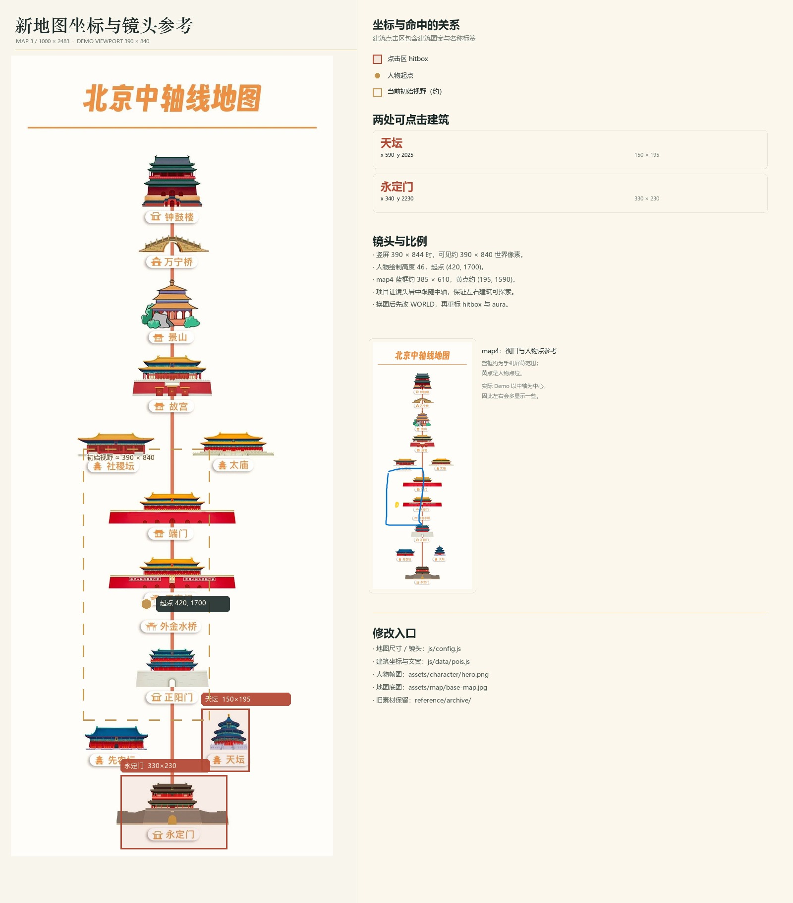

# 中轴寻迹 · 北京中轴线数字漫游 Demo

面向研究生课程作业的**可玩性验证 Demo**：手机扫码即玩，人物在中轴线地图行走；靠近建筑出现气泡，阅读资料、完成答题，点亮图鉴徽章并保存进度。

> **实现形态说明**：本项目是 **H5 + Canvas 2D 的移动端网页游戏**，不是微信原生小程序（`.wxml`）工程。它用手机浏览器扫码即可运行，适合课程演示和快速迭代。如果课程硬性要求提交微信小程序代码，玩法和数据结构可以迁移，但需要重写页面层与触摸适配，详见第 9 节。

---

## 1. 立即体验

### GitHub Pages（固定地址）

**https://taolegetao.github.io/zhongzhou-manxing/**


- 手机相机 / 微信扫一扫直接打开，无需登录。
- 由 GitHub Pages 托管，**电脑关机也能访问**；每次更新 `main` 分支后自动重新发布。
- 代码仓库：<https://github.com/taolegetao/zhongzhou-manxing>

### 同一 Wi-Fi 的本地入口（课堂备用）

电脑双击 `start-demo.bat` 后，手机连接同一个 Wi-Fi，扫描：


当前电脑的局域网地址：`http://10.4.35.161:4173/`  
（IP 可能随网络变化，以启动窗口打印的“手机访问”地址为准。）

### 分享海报 / 链接

- 海报 `扫码即玩.png` 是图片，不是可点击链接；对方需要**扫码或长按识别二维码**打开游戏。
- 也可以直接把 GitHub Pages 链接发到群里，点开即玩。
- 二维码在微信压缩到约 640px 宽、43KB 时仍可识别；不要裁掉二维码四角留白或贴纸遮挡。
- GitHub Pages 在部分校园网/移动网络下可能较慢；如果现场打不开，改用同一 Wi-Fi 的本地入口。

---

## 2. 本地启动（无代码操作）

1. 电脑安装 **Node.js 18 或更高版本**（<https://nodejs.org/>）。
2. 双击项目根目录的 **`start-demo.bat`**。
3. 保持弹出的黑色命令行窗口开启；约 2 秒后浏览器会自动打开 `http://localhost:4173`。
4. 手机与电脑连同一个 Wi-Fi，扫描 `qr-lan.png`；或手动输入窗口里打印的“手机访问”地址。
5. Windows 首次询问防火墙权限时，请选择**允许访问**。
6. 结束演示时，在命令行窗口按 `Ctrl + C`，或直接关闭窗口。

电脑也可以直接打开 `http://localhost:4173/qr.html` 查看并展示二维码。

### 常见问题

- **双击 `index.html` 打不开/白屏**：不能直接双击，ES Module 必须通过 HTTP 服务运行，请用 `start-demo.bat`。
- **端口被占用**：命令行执行 `node server.mjs --port 4174`，然后访问 `http://localhost:4174`。
- **手机打不开局域网地址**：确认同一 Wi-Fi、没有开启 AP 隔离；也可以直接扫 GitHub Pages 二维码。
- **GitHub Pages 打不开/加载慢**：换网络重试，或使用同一 Wi-Fi 的本地入口；公网地址不依赖电脑，但可能受网络环境影响。

---

## 3. 玩法（v1.3.1 原型）

- **四方位行走**：拖动左下角摇杆；桌面端也支持 `WASD` / 方向键。
- **靠近建筑**：人物从永定门前出发，走近建筑后上方出现“轻触了解”气泡。
- **看资料 + 答题**：点击气泡或建筑，打开资料卡；阅读导语、年表后完成 1 道小测。
- **点亮徽章**：答对后获得对应建筑徽章，自动写入图鉴并保存。
- **内容进度**：顶部进度条按“已完成闭环数 / 4”增长，不是人物在地图上的位置。
- **右侧系统列**：设置 / 存档 / 图鉴，三个按钮一列。
- **存档**：点击后弹出 4 个存档位，可保存、覆盖、读取；读取会确认替换当前进度。当前进度本身会自动保存，刷新后可“继续寻迹”。
- **图鉴**：4 枚可玩徽章：永定门、天坛、正阳门、故宫。
- **设置**：减少动效、大字模式、回到起点。

当前 4 个点位都使用同一套逻辑：**靠近 → 气泡 → 资料 → 1 题 → 徽章**。后续可继续追加建筑。

---

## 4. 已实现与验收点

- 原生 Canvas 2D 渲染，无运行时框架依赖。
- 四方向角色行走 + 序列帧动画 + 移动/停止状态切换。
- 平滑镜头跟随、地图边界钳制、响应式画布（DPR 适配）。
- 触屏虚拟摇杆、键盘输入、指针事件点击检测、摇杆与点击互不冲突。
- 四个点位点击介绍、答题奖励、徽章图鉴、四存档位、自动会话存档。
- 开始页、HUD、气泡、答题卡、图鉴、设置、存档、Toast、安全区适配、竖屏提示。
- 平板/桌面居中手机预览框，方便课堂投屏。
- 基础无障碍：按钮焦点、Esc 关闭、焦点陷阱、`aria-live` 提示、`prefers-reduced-motion`。
- 已用 Chrome + Puppeteer 在 `390×844`、`320×568`、`1280×900` 三种尺寸验收；交互测试无页面报错。

预览图：

- [开始页](./docs/preview-start.jpg)
- [靠近建筑，气泡出现](./docs/preview-game.jpg)
- [介绍卡与答题](./docs/preview-sheet.jpg)
- [答对后获得徽章](./docs/preview-reward.jpg)
- [图鉴：四点全部点亮](./docs/preview-atlas.jpg)
- [游玩进度 4 / 4](./docs/preview-progress.jpg)
- [四存档位](./docs/preview-save.jpg)

---

## 5. 地图、坐标与比例

### 项目地图

**项目地图是 `reference/map3-new.jpg`**，已复制为 `assets/map/base-map.jpg`，原始尺寸 **1000 × 2483**，是一张竖版中轴线信息图。

`map4-viewport-guide.jpg` 只用于参考蓝框视口与黄色人物点的位置，不直接用于游戏；旧版地图和旧头图已归档在 `reference/archive/`，没有删除。`reference/coordinate-guide.jpg` 标出了地图上的建筑点击范围、人物起点和初始镜头视野：



### 取景比例

- 竖屏 `390 × 844` 时，镜头约显示 **390 × 840 世界像素**，地图按原始像素 1:1 呈现。
- 蓝框约为 **385 × 610**，黄色人物点约在 `x = 195, y = 1590`；项目取近似比例，并让镜头以中轴线为中心跟随，保证手机竖屏能看到足够的轴线上下文。
- 人物绘制高度从旧地图的 56 调整为 **46 世界像素**，更贴近新地图中建筑与人物点的比例。
- 新地图很长，手机上是“局部漫游”，不是一次性铺满整张图。

### 当前坐标

| 对象 | 坐标 / 矩形（世界像素） |
| --- | --- |
| 地图 | `0, 0, 1000 × 2483` |
| 人物起点 | `x = 480, y = 2120`（永定门前） |
| 永定门点击区 | `x = 340, y = 2230, w = 330, h = 230` |
| 天坛点击区 | `x = 590, y = 2025, w = 150, h = 195` |
| 正阳门点击区 | `x = 360, y = 1800, w = 300, h = 210` |
| 故宫点击区 | `x = 360, y = 920, w = 300, h = 200` |

坐标原点为地图左上角，x 向右、y 向下。每个点位都有独立的 `bubble` 气泡锚点；点击区包含建筑图案与名称标签。

---

## 6. 替换素材

所有素材集中在 `assets/`，替换后刷新页面即可。

### 地图

- 路径：`assets/map/base-map.jpg`
- 当前为 **1000 × 2483** 的竖版信息图；替换时建议保持相同比例。
- 换图后需要按新图重新标注建筑的 `hitbox` 和 `aura`（见第 7 节）。
- 代码使用的是图片原始像素坐标，不依赖显示尺寸；换图后需同步修改 `js/config.js` 的 `WORLD`。

### 人物

- 路径：`assets/character/hero.png`
- 当前为 **3 列 × 4 行**，每格 **48 × 48**，共 12 帧。
- 行顺序：**下、左、右、上**。
- 每行 3 帧，当前按 `0 → 1 → 2 → 1` 循环。
- 替换时保持同样的网格，或同步修改 `js/config.js` 中的：
  - `frameWidth` / `frameHeight`
  - `columns` / `rows`
  - `rowByFacing`
  - `drawSize`
  - `frameDuration`

### 介绍卡头图

- 路径：`assets/covers/yongdingmen.jpg`
- 路径：`assets/covers/tiantan.jpg`
- 路径：`assets/covers/zhengyangmen.jpg`
- 路径：`assets/covers/gugong.jpg`
- 当前为 **720 × 360（2:1）**，从新地图中裁切，避免和介绍卡标题重复。
- 可直接替换为同比例照片或插画。

### 颜色与字体

- UI 颜色集中在 `css/style.css` 顶部的 `:root` 变量。
- 字体使用系统中文字体回退（宋体 / 苹方 / 微软雅黑），不依赖外网字体，离线可用。

---

## 7. 修改文案、位置与新增建筑

### 四个点位的文案

全部在 **`js/data/pois.js`**（永定门、天坛、正阳门、故宫）：

```js
{
  id: 'yongdingmen',
  name: '永定门',
  hitbox: { x: 340, y: 2230, width: 330, height: 230 },
  aura: { x: 480, y: 2380, rx: 135, ry: 24 },
  bubble: { x: 480, y: 2205 },
  lead: '...',
  body: '...',
  detail: { type: 'timeline', items: [...] },
  quiz: {
    question: '永定门在哪一年按清代形制原址复建？',
    options: ['1553 年', '1957 年', '2004 年'],
    answer: 2
  }
}
```

- `lead`：介绍卡第一段（大字）。
- `body`：第二段（正文）。
- `tags`：标签。
- `detail`：`timeline` 时间线，或 `route` 中轴序列。
- `hitbox`：手指可点击的矩形。
- `aura`：靠近时地面提示光环。
- `bubble`：靠近时气泡锚点。
- `quiz`：答题题干、选项、正确答案索引（从 0 开始）和反馈。

**图鉴徽章**在 `js/data/atlas.js`。新增建筑时，在 `POIS` 里追加内容，并在 `ATLAS_BADGES` 里追加徽章；4 个点位与 4 枚徽章一一对应。

### 存档与设置

**两层状态，职责分开：**

1. **当前游玩进度（自动会话存档）**
   - 键名：`zhongzhou-xunji-save-v2`
   - 内容：徽章集合、人物坐标、设置、时间。
   - 触发：答对题目、切换页面隐藏、修改设置、保存/读取存档后。
   - 作用：刷新页面后“继续寻迹”回到最近状态。

2. **手动存档位（4 个）**
   - 键名：`zhongzhou-xunji-slots-v1`
   - 每个位是一份独立快照：徽章、人物坐标、设置、保存时间。
   - 保存/覆盖/读取都只由用户点击触发；读取前会确认，并同时显示旧存档与当前进度的徽章数。
   - 读取会替换当前游玩进度，并同步更新顶部进度条与图鉴。

**设计约束：**

- 进度条只由徽章集合推导，不单独存“百分比”，避免和存档内容不一致。
- 自动存档不会修改 4 个手动存档位；手动存档也不会凭空增加徽章。
- 存档位显示“徽章数 + 位置”，避免两个同为 2/4 的存档无法区分。
- 写入失败时提示“存档失败”，不会误报成功。
- 读取前确认是最后一道保护；当前版本不提供“读取前快照”的撤销按钮。

### 人物、镜头、速度

在 **`js/config.js`**：

```js
PLAYER.start          // 出生点
PLAYER.speed          // 行走速度
PLAYER.bounds         // 可行走边界
VIEW.targetWorldWidth // 镜头远近：越小越近
VIEW.lookAheadY       // 镜头向北偏移
VIEW.proximity        // 出现“轻触查看”的距离
```

---

## 8. 代码结构

```text
zhongzhou-demo/
├─ index.html                 页面结构（开始页 / HUD / 气泡 / 介绍卡 / 图鉴 / 设置）
├─ css/style.css              视觉样式、动效、安全区与响应式
├─ js/
│  ├─ main.js                 启动、主循环、点击命中、答题/徽章/存档状态
│  ├─ config.js               地图 / 人物 / 镜头 / 边界参数
│  ├─ data/pois.js            永定门文案、坐标、头图与答题
│  ├─ data/atlas.js           4 枚可玩建筑徽章
│  ├─ core/assets.js          图片预加载
│  ├─ core/camera.js          世界坐标 ↔ 屏幕坐标、镜头跟随
│  ├─ core/player.js          四方位移动、边界、序列帧状态
│  ├─ core/input.js           触屏摇杆、键盘输入
│  ├─ core/progress.js        localStorage 存档/读档
│  ├─ render/scene.js         Canvas 分层渲染、人物、光环
│  └─ ui/ui.js                开始页、气泡、答题、图鉴、设置、焦点管理
├─ assets/
│  ├─ map/base-map.jpg        新竖版中轴线地图（map3）
│  ├─ character/hero.png      人物序列帧
│  └─ covers/                 永定门头图（天坛头图保留备用）
├─ server.mjs                 零依赖静态服务器（默认 4173 端口）
├─ start-demo.bat             双击启动
├─ qr.html / qr-*.png         扫码入口与二维码
├─ .github/workflows/          GitHub Actions：push 时做静态检查
├─ CHANGELOG.md               版本变更记录
├─ .nojekyll                  GitHub Pages 跳过 Jekyll
├─ reference/                 坐标与比例参考图
└─ docs/                      验收截图
```

运行时代码没有打包步骤、没有 `node_modules` 依赖；`server.mjs` 只负责把静态文件通过 HTTP 提供出来。

---

## 9. 后续可拓展性

### 9.1 遮挡关系（重点预留）

当前地图是一张**烘焙好的整图**，建筑已经画进底图，所以人物走到建筑下方时不会自动被遮住。渲染器已经按 y 值对实体排序：

```js
const entities = [
  { y: player.y, draw: () => this.drawPlayer(player) },
];
entities.sort((a, b) => a.y - b.y);
```

推荐两种落地方式：

1. **前景层方案（改动最小）**：在绘图软件中把需要遮挡的建筑前景（如城楼屋檐）抠成透明 PNG，放到 `assets/occlusion/`；在 POI 配置中增加 `foreground` 和 `baseY`，渲染时在 `entities` 里插入一个 `y = baseY` 的 sprite。人物 y 小于 baseY 时先画人物、后画前景，就会被遮挡。
2. **对象化地图方案（更彻底）**：地图只保留地面/道路，建筑拆成独立 sprite，统一进入 y-sort 实体层；可同时支持碰撞、排序和更丰富的动画。

### 9.2 其他方向

- **更多遗产点**：在 `js/data/pois.js` 添加内容、在 `js/data/atlas.js` 添加徽章，即可进入现有答题/图鉴体系。
- **任务系统**：当前答题已经是第一个任务，可扩展为“按顺序打卡”“多题解锁”“寻找类任务”。
- **UI 换肤**：颜色、圆角、字体在 `:root` 和组件样式中集中管理；可替换为更现代的国潮/极简风。
- **小地图**：`Camera.worldToScreen` 与地图尺寸可直接复用。
- **音效与语音**：在 `openPoi` / 移动状态切换处挂音频；注意移动端需要用户手势后播放。
- **存档**：已使用 localStorage 保存当前会话，并提供 4 个手动存档位；后续可扩展多存档槽或云端同步。
- **碰撞**：在 `Player.update` 中加矩形/圆形碰撞即可；建议只对建筑主体加碰撞，不要把地图标签也挡住。
- **微信小程序迁移**：Canvas 2D API、POI 数据结构、镜头/人物逻辑可以复用；需要把 DOM UI 改为 WXML/WXSS，把 `pointerdown` 改为 `bindtouchstart`，并处理小程序域名与 `web-view` 限制。当前 H5 版本更适合“扫码即玩”的课程验收。

---

## 10. GitHub 部署与版本迭代

### 仓库与 Pages 配置

- 仓库：<https://github.com/taolegetao/zhongzhou-manxing>
- Pages：<https://taolegetao.github.io/zhongzhou-manxing/>
- 发布方式：**GitHub Pages 直接发布 `main` 分支根目录**，没有构建步骤，也不需要额外的部署 Action。
- 仓库根目录的 `.nojekyll` 让 Pages 跳过 Jekyll；`.github/workflows/static-check.yml` 在每次 push 时做 JS 语法和关键素材检查。

这意味着：**以后只要 `main` 有新提交，网页会自动更新**，通常 1 分钟内生效。

### 三种更新方式

1. **改文案/坐标（最简单）**  
   在 GitHub 网页打开 `js/data/pois.js` 或 `js/config.js`，点铅笔图标修改，提交到 `main`。页面自动重新发布。
2. **换图片/海报**  
   在仓库对应目录点 `Add file` → `Upload files`，覆盖 `assets/...`、`qr-public.png` 或 `扫码即玩.png`，提交到 `main`。
3. **本地改完再发布**  
   克隆仓库（或直接改本地 `zhongzhou-demo`），双击 `start-demo.bat` 预览；确认后把修改提交并 push 到 `main`。

### 版本号约定

项目采用语义化版本：

- `v1.0.1`：修 bug / 改文案 / 换小图。
- `v1.1.0`：新增建筑、玩法、界面模块。
- `v2.0.0`：大的交互或数据结构改造。

每次发布建议：

1. 更新 `CHANGELOG.md` 和 `package.json` 的 `version`。
2. 在 GitHub 右侧 **Releases → Draft a new release**，创建 `vX.Y.Z` tag。
3. 写清本次新增/修改，方便课程展示和后续回滚。
4. Pages 不需要手动部署，`main` 更新后自动生效。

### 回滚

GitHub → Commits / Releases 找到上一个版本，使用 **Revert** 或把 tag 对应的代码重新提交到 `main` 即可。GitHub Pages 会自动回到旧版本。

### 其他静态托管（备选）

- **Netlify / Cloudflare Pages / Vercel**：把仓库连接到平台，构建命令留空，发布目录填 `/`。
- **腾讯云静态网站托管 / 阿里云 OSS**：上传 `zhongzhou-demo-deploy.zip` 解压后的内容，首页设为 `index.html`。
- **课堂局域网**：双击 `start-demo.bat`，手机同 Wi-Fi 扫描 `qr-lan.png`。

> 二维码只是网址的图片。换域名后，用新网址重新生成 `qr-public.png`，并同步更新 `qr.html`、`README.md` 和海报。

---

## 11. 已知限制

- 这是 **H5 网页 Demo**，不是微信原生小程序包；微信内打开依赖浏览器内核，个别旧版微信可能限制自动播放/全屏，但本项目没有音频和全屏依赖。
- 地图是单张位图，**没有真实遮挡与碰撞**；人物可以走过建筑图案。遮挡方案见 9.1。
- 仓库是公开的，地图、人物序列帧和介绍文字会一并公开；如果课程要求素材保密，需要改为私有托管或做素材授权处理。
- GitHub Pages 在部分校园网/移动网络下可能较慢或间歇不可达；课堂现场建议同时保留同一 Wi-Fi 的本地入口。
- 部分网络可以打开 `github.io` / `api.github.com`，但打不开 `github.com` 主站；这不影响别人访问网页，但进入仓库后台修改时需要换网络或使用代理。
- 文案根据课程素材与公开资料整理；当前开放永定门、天坛、正阳门、故宫四个点位，内容仍可继续校订。
- 当前做了 4 个可交互点位，符合本阶段“4 个内容闭环”的范围。

---

## 12. 验收记录

- Chrome Headless + Puppeteer，移动端视口 `390 × 844`：四个点位均可走近出现气泡、打开资料卡、答错重试、答对获得徽章；顶部闭环进度 `0 / 4 → 4 / 4`；图鉴四枚徽章全部点亮。
- 存档位：四个空位可保存；保存后显示时间、徽章数与位置；可覆盖保存；读取前弹出确认并显示“旧存档 1/4 → 当前 4/4”，读取后恢复徽章与位置；刷新后“继续寻迹”保留自动会话。
- 存档失败（模拟 localStorage 写入异常）：提示“存档失败”，对应存档位保持空位，不会误报成功。
- 小屏 `320 × 568`：资料卡内部滚动，答题区、四宫格存档、图鉴不溢出。
- 桌面 `1280 × 900`：应用以 560px 手机画幅居中显示，系统列、图鉴、存档位正常。
- 修复了答错后正确选项被禁用的问题，以及触屏 `pointerup` 补发 `click` 导致介绍卡刚打开就被关闭的问题（420ms 防误触窗口）。
- 运行 `node --check` 检查全部 JS 模块语法通过。
