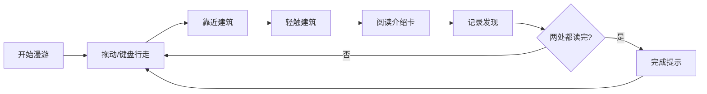
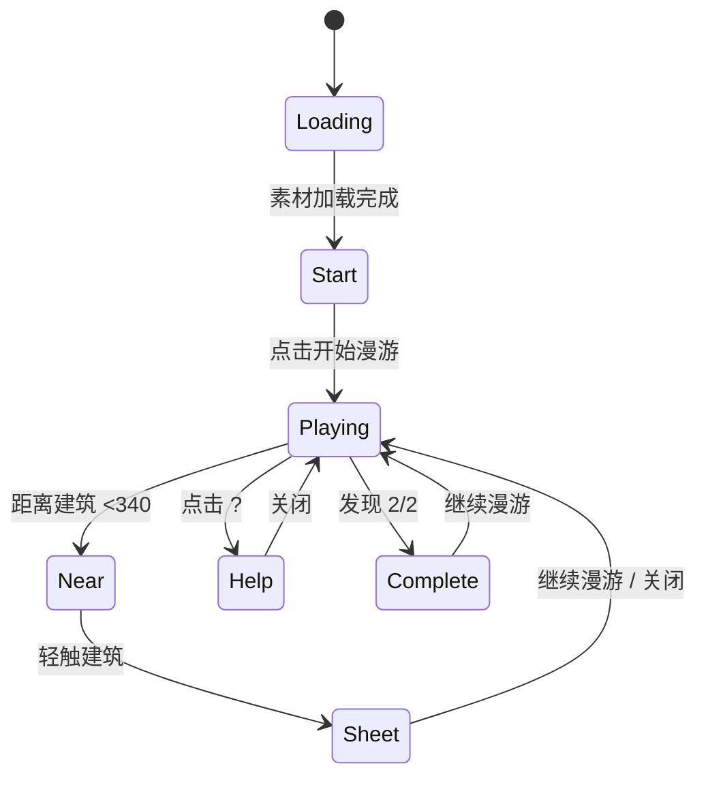

# 中轴寻迹 · 设计系统与交互设计

版本：v1.1.2  
形态：移动端 H5 / Canvas 2D 文化漫游 Demo  
主题：北京中轴线 · 永定门 / 天坛

---

## 0. 设计定位

### 一句话

**以“纸本中轴”为视觉母题，把一次城市漫游压缩成 3 分钟的轻量文化探索。**

### 体验目标

- 不是闯关游戏，而是 **走—看—读—收集** 的低压力探索。
- 玩家不需要学习复杂规则，30 秒内能理解“拖摇杆、点建筑”。
- 读完两处遗产点，形成一次完整的“中轴漫游”记忆。

### 体验关键词

| 关键词 | 含义 | 设计落点 |
| --- | --- | --- |
| 克制 | 不堆 UI、不打断漫游 | 纸色 HUD、少量朱红强调 |
| 可读 | 建筑与文字优先 | 地图局部取景、卡片式科普 |
| 可探索 | 玩家自己走向建筑 | 镜头跟随、靠近提示 |
| 文化温度 | 不做成通用游戏皮肤 | 宋体、印章、轴线、金线 |
| 轻量 | 课程 Demo 可完成、可迭代 | 无后端、无失败、无强制任务 |

### 非目标

- 不做战斗、排行榜、复杂养成。
- 不做重度 3D 或真实地理 GIS。
- 不追求商业级内容量；当前聚焦两处遗产点。

---

## 1. 设计原则

### 1.1 以轴为骨

地图、镜头、进度、排版都围绕一条垂直中轴线组织。轴线既是地理线，也是视觉骨架。

- 顶部中轴进度条：永定门 · 南 → 钟鼓楼 · 北。
- 地图中建筑沿中轴纵向排列。
- 介绍卡的编号、时间线、装饰线都使用“轴线/刻度”的语言。

### 1.2 以纸为底

所有界面都像一张摊开的纸本手账，而不是黑色游戏 HUD。

- 纸色 `#F4EEE0` / `#FBF7ED` 作为底层。
- 墨色承担文字与主按钮。
- 朱红只用于印章、重点和完成状态。
- 金色用于轴线、边框、强调线，面积很小。

### 1.3 一步一景

不做整图俯视，而是用局部镜头制造“走着看”的节奏。

- 当前取景约 **390 × 840 世界像素**。
- 人物略偏屏幕下方，前方留出探索空间。
- 建筑比屏幕大时，允许画面裁切，形成“走近”的压迫感。

### 1.4 轻触即读

文化内容不做强制任务，玩家看到建筑、点一下就能读。

- 点击区包含建筑和下方标签，手指容易命中。
- 靠近时出现地面光环和“轻触「天坛」”提示。
- 介绍卡以博物馆标签的方式组织，而不是大段说明文。

### 1.5 不打断漫游

弹窗是“暂停阅读”，不是“跳出游戏”。

- 打开介绍卡时暂停输入，关闭后回到原位。
- 没有失败、没有倒计时、没有强制下一步。
- 完成两处后只给一个短 Toast，不切场景。

---

## 2. 视觉系统

### 2.1 视觉概念

**纸本中轴 / 数字手账 / 博物馆标签 / 像素旅人**

- 地图是插画式信息图，偏“纸本”。
- 人物是像素序列帧，形成轻微的时代错位和游戏感。
- 字体以宋体为文化声线，以黑体承担操作信息。
- 印章与朱红是品牌记忆点，不依赖 Logo。

### 2.2 色彩 Token

| Token | 色值 | 语义 | 使用位置 |
| --- | --- | --- | --- |
| `--paper` | `#F4EEE0` | 纸底 | 页面底色、地图留白 |
| `--paper-strong` | `#FBF7ED` | 高亮纸 | 卡片、面板、按钮底 |
| `--paper-deep` | `#E9DFCA` | 旧纸 | 分隔、次级底 |
| `--ink` | `#1B2928` | 墨 | 主文字、主按钮 |
| `--ink-soft` | `#3B4B47` | 淡墨 | 正文、次级文字 |
| `--muted` | `#6F7A73` | 灰墨 | 注释、来源 |
| `--red` | `#B34834` | 朱红 | 印章、重点、进度 |
| `--red-deep` | `#8E3327` | 深朱 | 印章渐变、阴影 |
| `--gold` | `#C29553` | 金 | 轴线、边框、装饰线 |
| `--gold-light` | `#E2C891` | 浅金 | 聚焦、完成、微光 |
| `--jade` | `#5F7B6B` | 青 | 当前为保留色，可用于侧坛/自然 |

**用色比例建议：纸 70% / 墨 20% / 朱红 6% / 金 3% / 青 1%。**  
朱红和金是“印章式”强调，不能大面积铺开。

### 2.3 字体系统

| 层级 | 字体 | 字号 | 用途 |
| --- | --- | --- | --- |
| 品牌大标题 | 宋体 | 48–64px | 开始页「中轴寻迹」 |
| 页面标题 | 宋体 | 27–33px | 介绍卡、帮助卡 |
| 卡片导语 | 宋体 | 14.5px | 建筑介绍第一段 |
| 正文 | 黑体 | 12px | 建筑介绍第二段 |
| 控件 | 黑体 | 11–12px | 按钮、标签 |
| 元信息 | 黑体 | 7.5–10px | 编号、坐标、注释 |
| 英文小标 | 黑体大写 | 6.5–8px | 博物馆式副标 |

**原则：**

- 宋体负责“文化叙事”，黑体负责“操作与信息”。
- 大字用宋体制造碑刻/书页感；小字用黑体保证屏幕可读。
- 英文小标全部大写、宽字距，作为展览标签的语气。

> 审计提示：当前元信息最小到 6.5–8px，属于视觉风格的一部分，但可读性偏低。下一版建议将关键元信息提高到 10–11px。

### 2.4 间距、圆角与阴影

当前实现并不是严格 4px 网格，而是“纸片层叠”的近似值：

| 类型 | 当前值 | 建议规范 |
| --- | --- | --- |
| 间距 | 4 / 6 / 8 / 10 / 12 / 16 / 22 / 24 | 统一到 4 / 8 / 12 / 16 / 24 / 32 |
| 圆角-小 | 6–8px | 8px |
| 圆角-中 | 10–16px | 12 / 16px |
| 圆角-大 | 24–30px | 24px |
| 胶囊 | 999px | 999px |
| 浮层阴影 | `0 12px 34px rgba(24,36,32,.16)` | 保持 |
| 介绍卡阴影 | `0 -18px 62px rgba(11,20,17,.28)` | 保持 |

阴影只用于“纸片浮起”，不用发光、不用霓虹。

### 2.5 品牌母题

1. **印章**：开始页 51×51 的朱红“轴”印；POI 卡右下角“南/天”印。
2. **中轴线**：地图竖线、顶部进度条、卡片分隔线。
3. **金线**：极细的 `1px` 横线/竖线，制造装帧感。
4. **纸纹**：全屏 `feTurbulence` 噪点，透明度约 4.5%，只做触感，不抢内容。
5. **留白**：地图和卡片都保留大量空白，让建筑和文字呼吸。

---

## 3. 界面架构

### 3.1 层级

```text
页面
├─ 场景层 Stage
│  ├─ Canvas 地图
│  ├─ 暗角 / 纸纹
│  ├─ HUD（品牌 / 发现 / 帮助）
│  ├─ 中轴进度条
│  ├─ 靠近提示
│  ├─ 摇杆 / 归位 / 操作提示
│  └─ Toast
├─ 开始页 Start Screen
├─ 介绍卡 Sheet
└─ 帮助卡 Help
```

### 3.2 手机竖屏布局

- 顶部：品牌 + 发现 + 帮助，安全区内边距 12–16px。
- 第二行：中轴进度条，距顶部约 72px。
- 底部：左侧 114px 摇杆，右侧“归位”和操作提示。
- 中间：地图与人物，靠近提示悬浮在摇杆上方。
- 介绍卡：底部抽屉，最大高度 91dvh；桌面端居中为 478px 卡片。

### 3.3 响应式

| 视口 | 策略 |
| --- | --- |
| 320×568 | 摇杆缩到 104px，隐藏品牌英文，卡片内容可滚动 |
| 390×844 | 主设计尺寸，取景约 390×840 世界像素 |
| 560 以上 | 应用最大 560px，居中显示手机画幅 |
| 横屏且高度 <520 | 显示“请竖屏”提示层 |

---

## 4. 组件系统

| 组件 | 作用 | 状态 | 关键规格 |
| --- | --- | --- | --- |
| 品牌印章 | 视觉锚点 | 静态 | 35×35，朱红渐变，8px 圆角 |
| 发现 Chip | 收集进度 | 默认 / 增加 / 完成 | 36px 高，胶囊，完成态反色 |
| 帮助按钮 | 打开玩法 | 默认 / hover / focus | 36px 圆，`?` 宋体 |
| 中轴进度条 | 空间感/进度 | 0–100% | 2px 轨道，7px 圆点 |
| 靠近提示 | 告知可点击 | 隐藏 / 显示 | 深墨胶囊，金色小点 |
| 摇杆 | 四方向移动 | idle / active | 114px 底座，46px 摇杆头 |
| 归位按钮 | 回到起点 | 默认 / hover | 47px 圆 |
| Toast | 轻反馈 | 显示 / 隐藏 | 深墨胶囊，10px 字 |
| 开始页 | 建立氛围/规则 | loading / ready / leaving | 品牌大标题 + 单一主按钮 |
| 介绍卡 | 科普阅读 | 打开 / 滚动 / 关闭 | 底部抽屉，最大 91dvh |
| 标签 | 关键词 | 静态 | 4px 圆角，金色描边 |
| 时间线 | 历史信息 | 静态 | 3 列，年份宋体朱红 |
| 主按钮 | 继续/开始 | 默认 / hover / focus | 48–51px 高，墨底金边 |
| 帮助卡 | 规则说明 | 打开 / 关闭 | 居中 405px 卡片 |

### 组件语气

- 按钮是“印章/纸签”，不是“游戏按钮”。
- 卡片是“博物馆展签”，不是“弹窗广告”。
- 反馈是“轻轻出现/消失”，不是“弹跳/闪烁”。

---

## 5. 世界与镜头系统

| 参数 | 当前值 | 说明 |
| --- | --- | --- |
| 地图世界 | `1000 × 2483` | 竖版中轴线信息图 |
| 取景宽度 | `390` 世界像素 | 手机竖屏约 1:1 |
| 人物绘制高度 | `46` | 与建筑比例协调 |
| 人物速度 | `126` 世界像素/秒 | 走完全图约 15–20 秒 |
| 镜头前视 | `-60` | 略向北看，留出前方空间 |
| 镜头跟随 | `8.5` 指数平滑 | 不硬跟随，略有阻尼 |
| 靠近阈值 | `340` 世界像素 | 出现“可探索”提示 |
| 点击外扩 | `6` 世界像素 | 手指容错 |
| 地图边界 | x `100–900`，y `100–2440` | 不走出画面 |

### 渲染层次

```text
1. 地图底图
2. 地面光环 / 可探索提示
3. 按 y 排序的实体（人物、未来 NPC/前景建筑）
4. 屏幕空间焦点角标
5. DOM HUD / 弹窗
```

`y` 排序层是未来做遮挡关系的接口：把建筑前景作为更高 `y` 的 sprite 插入即可。

---

## 6. 交互设计

### 6.1 核心循环



### 6.2 输入模型

| 输入 | 行为 | 细节 |
| --- | --- | --- |
| 虚拟摇杆 | 四方向移动 | 死区 0.1，摇杆头最大偏移 32px |
| 键盘 WASD / 方向键 | 四方向移动 | 与摇杆向量合并，限幅到 1 |
| Canvas 轻触 | 点击建筑 | 按下/抬起位移 <12px，时长 <700ms |
| 空白点击 | 无反馈 | 不惩罚、不弹提示 |
| `Esc` | 关闭当前弹窗 | 帮助卡 / 介绍卡 |
| 归位 | 回到起点 | 不重置发现进度 |

### 6.3 状态机



### 6.4 点击判定的三个关键规则

1. **只认短按**：移动超过 12px 或按住超过 700ms 不算点击，避免拖摇杆/滑屏误触。
2. **点击区大于图形**：`hitbox` 包含建筑与名称标签，并额外外扩 6px。
3. **防“穿透点击”**：介绍卡打开后的 420ms 内忽略关闭，避免触屏 `pointerup` 后补发的 `click` 把刚打开的卡片关掉。

### 6.5 反馈矩阵

| 玩家行为 | 视觉反馈 | 文本反馈 | 状态变化 |
| --- | --- | --- | --- |
| 开始 | 开始页淡出 + 地图出现 | “沿中轴向南…” | 进入 Playing |
| 移动 | 人物四方向帧 + 镜头跟随 | 无 | 位置变化 |
| 靠近 | 地面光环 + 角标 | “轻触「天坛」…” | Near |
| 点击建筑 | 底部卡片上滑 | 标题/标签/年表 | 记录发现 |
| 读完后关闭 | 顶部计数变化 | 完成 Toast | Complete |
| 归位 | 镜头回到起点 | “已回到起点…” | 位置重置 |
| 出错 | 开始页显示错误文案 | 素材加载失败 | 不进入游戏 |

### 6.6 边界情况

- 建筑比屏幕宽：不画四角焦点，只保留地面光环。
- 建筑靠近 HUD/摇杆：不画角标，避免与 UI 重叠。
- 弹窗打开：暂停输入，不暂停页面渲染。
- 页面隐藏：重置输入，避免“按住键盘切后台”卡住。
- 小屏：介绍卡内部滚动，底部按钮固定可见。
- 横屏：显示竖屏提示，不进入游戏。

---

## 7. 内容设计

### 7.1 POI 卡片结构

```text
编号 01/02
头图（2:1，建筑局部）
Kicker（一句话定位）
标题（2–3 字）
英文名
导语（1 句，说明“是什么”）
标签（3 个关键词）
时间线（3 个年份）
正文（1 段，说明“为什么重要”）
来源说明
继续漫游
```

### 7.2 语气

- 说明性、克制、可引用，不用“震撼”“必看”等营销词。
- 先给定位，再给时间，再给价值。
- 数字用阿拉伯数字，年份保留全称；空间单位用“公顷/公里”。

### 7.3 两处内容差异

| 建筑 | 叙事重点 | 内容结构 |
| --- | --- | --- |
| 永定门 | 南端起点、复建、轴线串联 | 城门年表（1553/1957/2004） |
| 天坛 | 祭天祈谷、世界遗产、天圆地方 | 天坛年表（1420/1530/1998） |

---

## 8. 可访问性与响应式

已做：

- 按钮 `:focus-visible` 金色描边。
- 介绍卡/帮助卡焦点陷阱。
- `aria-live` 提示发现计数与靠近提示。
- `prefers-reduced-motion` 降低动效。
- 安全区 `env(safe-area-inset-*)`。
- 320px 小屏与桌面居中画幅。

待改进：

- 关闭/帮助按钮 34–36px，低于 44px 建议触控尺寸。
- 元信息 6.5–10px 偏小；建议关键信息 ≥11px。
- 部分灰墨文字对纸底对比度偏低。
- Canvas 地图对屏幕阅读器不友好，需要额外文字导览。
- 介绍卡正文可增加“朗读/字号调节”。

---

## 9. 设计系统的代码落点

| 设计系统 | 代码位置 |
| --- | --- |
| 颜色/字体/阴影 | `css/style.css` 的 `:root` |
| 地图/镜头/人物 | `js/config.js` 的 `WORLD / VIEW / PLAYER` |
| 建筑内容/坐标 | `js/data/pois.js` |
| 渲染层级/光环/角标 | `js/render/scene.js` |
| 交互状态/点击判定 | `js/main.js` |
| 弹窗/焦点/Toast | `js/ui/ui.js` |
| 版本与发布 | `CHANGELOG.md`、GitHub Releases |

### 扩展一个新建筑

1. 在 `POIS` 复制一项，改 `id / name / cover / hitbox / aura / 文案`。
2. 发现计数与头图预加载自动读取数组长度。
3. 若要新增内容类型，在 `UI.renderDetail()` 增加一种 `detail.type`。
4. 若要新增前景遮挡，把前景 sprite 插入 `SceneRenderer` 的实体排序数组，`y` 取建筑底部。

---

## 10. 审计与迭代建议

### 做得好的地方

- 视觉母题统一：纸、墨、朱、金贯穿开始页、HUD、卡片、海报。
- 交互负担低：只有一个摇杆 + 一个点击动作。
- 内容结构可扩展：POI 数据驱动，新增建筑不需要重写 UI。
- 细节完整：防误触、焦点陷阱、安全区、减少动效都考虑了。
- 有明确的“可玩性验证”边界，没有过度设计。

### 主要问题

1. **地图是整张位图**，没有真实遮挡/碰撞；人物会走过建筑图案。
2. **只有两处可交互**，地图上其他建筑没有反馈，容易产生“为什么这个点不了”的疑问。
3. **文字偏小**，在 320px 屏幕上尤其明显。
4. **没有存档**，刷新后进度清零。
5. **发现进度是唯一目标**，缺少可重复游玩的理由。
6. **地图与游戏的叙事关系**还可以更强：目前是“走地图 + 弹卡片”，可以增加路线任务、对话或声音。

### 下一版优先级

- P0：把帮助/关闭按钮增大到 44px；关键元信息提升到 10–11px。
- P1：增加 `localStorage` 存档与“已发现”地图标记。
- P1：为其他建筑增加“不可探索”的弱提示，减少误解。
- P2：加一条“中轴路线”任务，把两处遗产点串成顺序。
- P2：做建筑前景层，实现真正的 y-sort 遮挡。
- P3：加入环境音/翻页音，但必须绑定用户手势。

---

## 附：设计系统一句话总结

**用纸本的克制承载中轴线的秩序，用像素人物的轻游戏感降低文化门槛；交互只保留“走”和“点”，让内容成为主角。**
